# OpenSCAD GUI Mejorada

**Point-and-click modelling for OpenSCAD, with mechanical parts and fits taken from engineering
handbooks.** Build parts with buttons, a model tree and a 3D view. Every action is written as plain
OpenSCAD code that you can read, edit by hand and open in regular OpenSCAD.

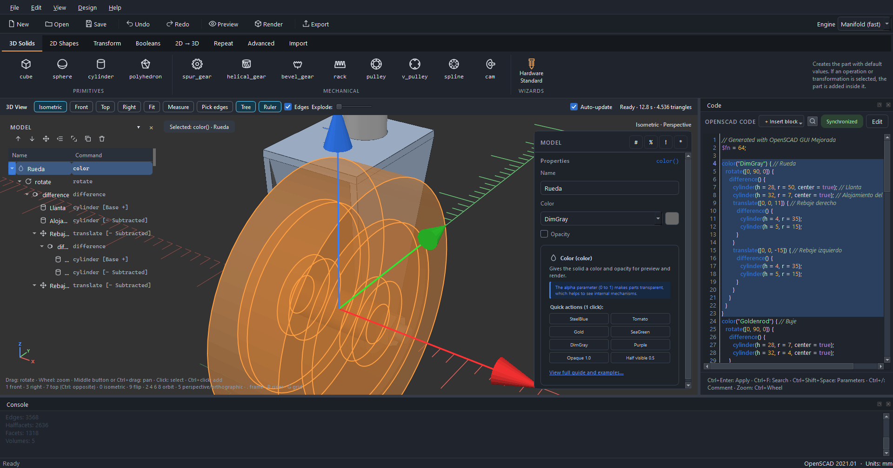

> **Unofficial.** This is an independent side project. It is not affiliated with or endorsed by the
> OpenSCAD project. It does not replace or modify OpenSCAD: it drives your installed copy from the
> command line, and every file it saves is standard OpenSCAD code.

## Who it is for

- **OpenSCAD beginners** who open the editor, see an empty code window and do not know where to
  start. Click a part, watch its code appear, and learn the language by reading it.
- **People who design functional parts** (gears, pulleys, shafts, bearing housings) and want the
  dimensions from a standard rather than from a guess.
- **OpenSCAD users** who want a quick visual way to place things or check a fit, without giving up
  their `.scad` files.

## What makes it different

- **Your file stays OpenSCAD.** Clicking writes plain code, and code you type is read back into the
  tree. Anything the tree cannot represent (variables, `for` loops, `if`, your own modules,
  `include`) is kept exactly as written, shown with a lock icon. Opening and saving never drops code.
- **No library to install.** The extra modules it uses (gears, rounded edges, splines…) are written
  at the end of the file, so the `.scad` opens on any OpenSCAD 2021.01 or newer.
- **Dimensions come from cited sources.** Gears, pulleys, splines, keyways, retaining ring grooves,
  O-ring grooves and bearing fits use tables from *Machinery's Handbook* (27th ed.) and *Shigley's
  Mechanical Engineering Design*; pipe flanges use the tables of ASME B16.5 and EN 1092-1. Each
  source is named in the code and in this README.
- **The geometry is checked against OpenSCAD itself.** Each mechanical part has a test that renders
  it with the real OpenSCAD and compares its volume with the program's own calculation, so the
  quick preview and the exported part are the same shape.

## Features

### Modelling
- Ribbon with the OpenSCAD primitives, transformations, booleans and extrusions; the property panel
  is built from each module's parameters.
- Model tree with multi-selection, drag and drop, wrap and unwrap, duplicate, and the `# % ! *`
  modifiers. It can float over the 3D view, like the browser in Fusion.
- **Rounded and chamfered edges**: click edges of a `cube`, or the rim of a `cylinder`, in the 3D view.
- **Arrays**: linear, polar and grid, written as plain `for` loops and recognised again on reopening.
- Boolean helper that shows which solid is the base of a `difference` and which are subtracted.
- Global variables panel, and *convert selection to a parametric module*.
- 2D profile wizard: rounded rectangles, slots, polygons, stars, rings, L profiles.

### Mechanical parts
All by module (metric). The panel shows the calculated dimensions and warns about design problems.

| Part | What you get |
|---|---|
| Spur gear | Involute profile, undercut warning, button that adds the mating gear already placed and in phase |
| Helical gear | Normal module and pressure angle, lead, twist and axial overlap; the mate is made with the opposite hand |
| Herringbone gear | Two opposite-hand helical halves meeting in phase at the centre plane: cancels axial thrust, no thrust bearing needed; mates like a plain helical gear |
| Bevel gear | Straight bevel from the Handbook's milled-bevel formulas; the mate is the same part turned by the shaft angle |
| Rack | Straight or helical, meshes with a gear placed on it |
| Timing pulley | MXL, XL, L, H, XH sections (ANSI/RMA IP-24), optional flanges |
| V-belt pulley | A, B, C, D sections (ANSI/RMA IP-20), groove angle by diameter range |
| Involute spline | Shaft and hub (ANSI B92.2M / ISO 4156), 30°, 37.5° and 45°; the hub is added in place, already meshing |
| Keyways | On gears and pulleys, sized by bore from BS 4235-1 / ISO R773 |
| Plate cam | Rise, dwell and fall with the cycloidal, harmonic, parabolic or constant-velocity law (*Machinery's Handbook*, «Cams and Cam Design») |
| Transmission calculator | Gear tooth counts, or timing and V-belt pulleys with the belt length, for a ratio or a pair of speeds, created already in place ([see below](#transmission-calculator)) |
| Camshaft (in progress) | Main shaft and lobes as separate parts: each lobe has its own axial position, nose angle, law, lift and rise/fall angles (asymmetric lobes allowed) |

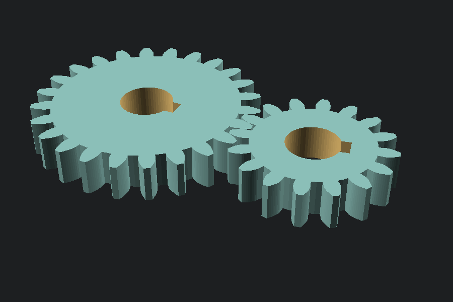

| | |
|---|---|
| 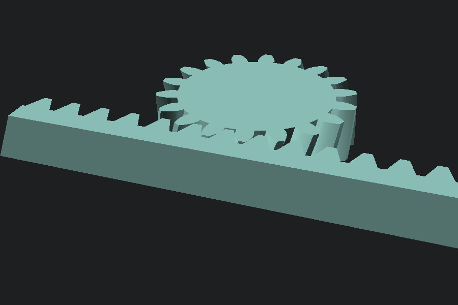 | 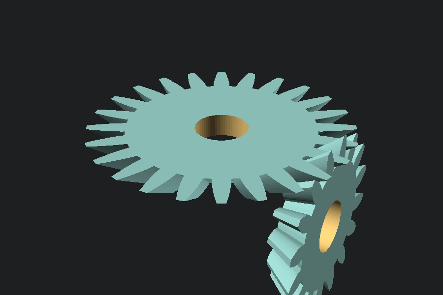 |
| 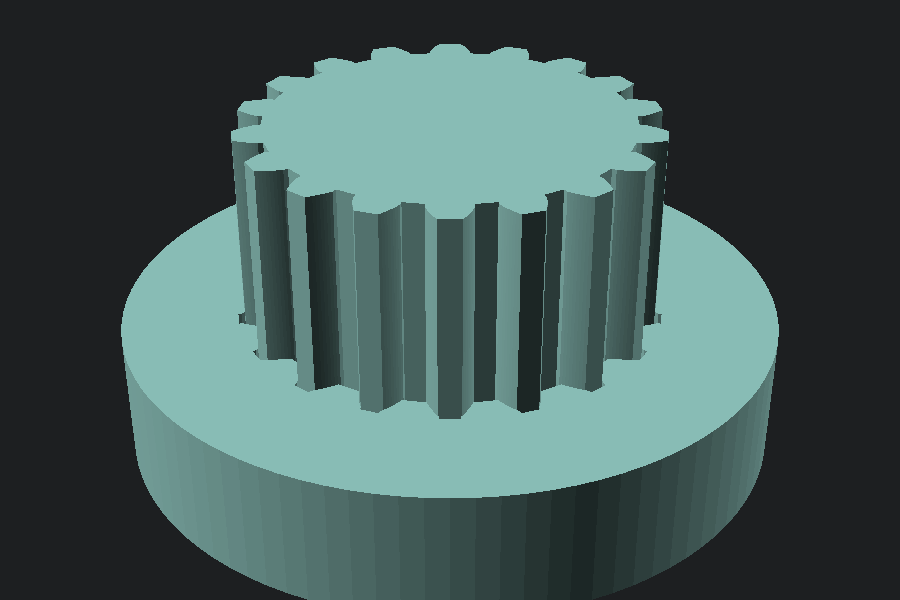 | 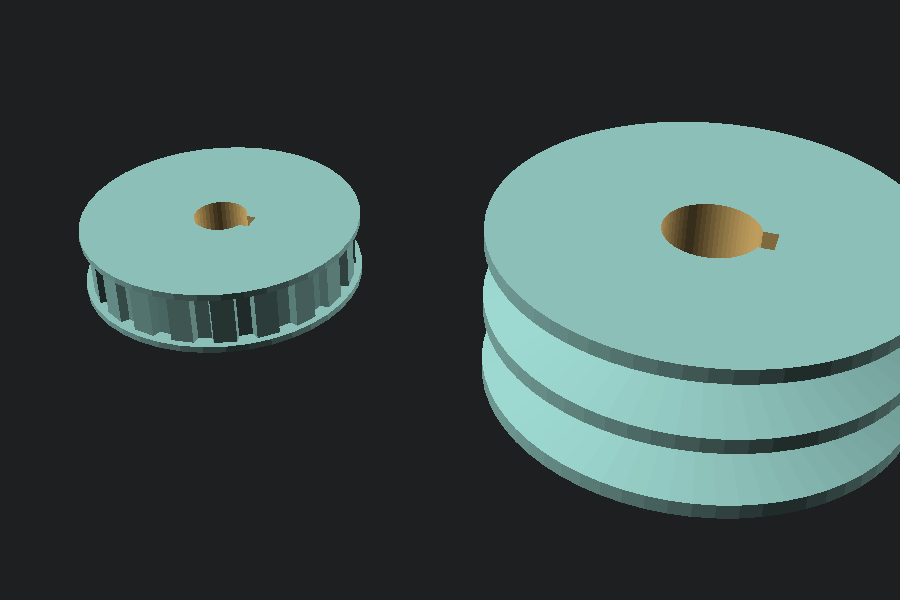 |

#### Transmission calculator
*Mechanical › Wizards › Transmission calculator*, or *Design › Transmission calculator…*. Tell it what you
need and it finds the gears, or the pulleys and the belt:

- **Input**: a speed ratio (3.75 means the output turns 3.75 times slower) or the input and output
  speeds in rpm, with a tolerance in %. A ratio below 1 is a speed-up.
- **Drive by**: gears, a timing belt or a V-belt.

**Gears**

- **Layout**: one stage, two stages (compound train, for large ratios without tiny pinions) or a
  reverted train, with the input and output shafts on the same axis.
- **Limits**: minimum and maximum teeth (the minimum starts at the undercut limit for the gear type and
  helix angle) and, optionally, a maximum centre distance per stage.
- **Results**: every tooth combination within the tolerance, sorted by error, then by hunting-tooth
  pairs (no common factor, so the wear is spread over all the teeth), then by size. Each row shows the
  actual ratio, the error, the centre distances and the pitch diameters; the selected one also shows
  the output speed and any warning.
- **Create gears**: adds a group with the spur, helical or herringbone gears already placed and in
  phase. Gears that mesh get opposite helix hands; the two on the intermediate shaft get the same hand,
  so their axial thrusts cancel. Each gear stays a normal part you can edit afterwards.

**Timing belt** (MXL, XL, L, H, XH)

- Finds the tooth counts of both pulleys for the ratio, which is exact. The belt must have a whole
  number of teeth, so its length is rounded to the nearest tooth for the centre distance you give (or
  an automatic one) and the real centre distance is worked out from it.
- Shows the belt (teeth and length), the wrap angle, and how many teeth of the small pulley the belt
  wraps. Fewer than 6 is flagged, since the belt can jump, and such combinations are listed last.

**V-belt** (A, B, C, D)

- Tries round datum diameters (multiples of the step you choose, from the section's recommended
  minimum) and gives the belt's pitch length. Enter the length of a belt from your catalogue and the
  centre distance is recalculated for it. Catalogue lengths are not built in, because they vary by
  maker. Slip (1–2 %) is not included in the ratio.
- Warns about a wrap angle below 120°, a belt speed above 30 m/s, and the pulley warnings (diameter
  below the recommended minimum, bore too large).

**Create pulleys** adds the two pulleys at the calculated distance and, if you want, the belt as a
plain grey band along its path (no teeth; one per groove on a V-belt) to check clearances. It is a
normal part you can hide or delete.

The search is exact kinematics only: it does not size the module or the belt from power or torque.

| | |
|---|---|
| 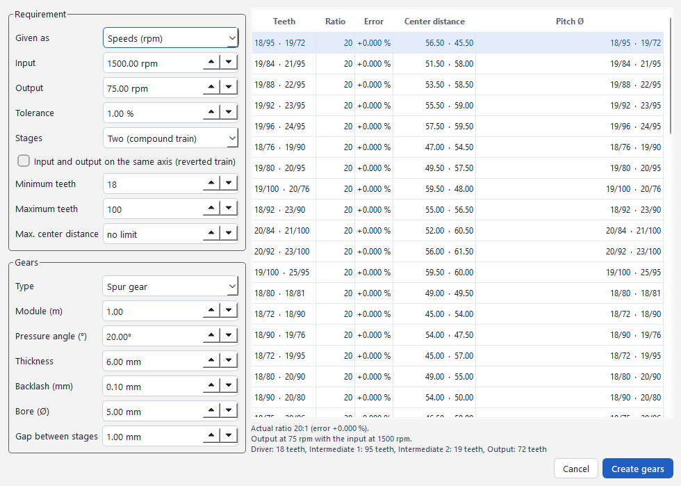 | 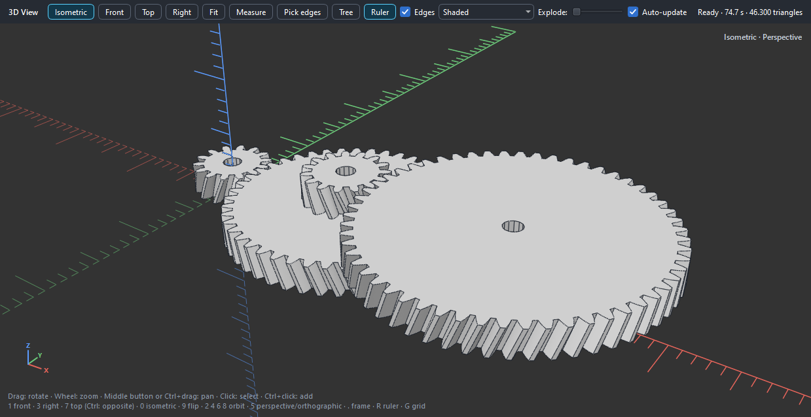 |
| 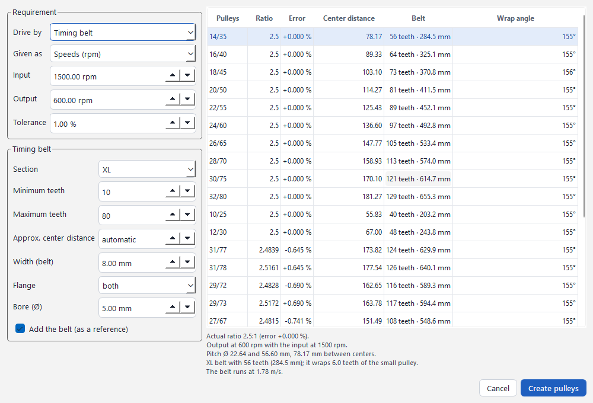 | 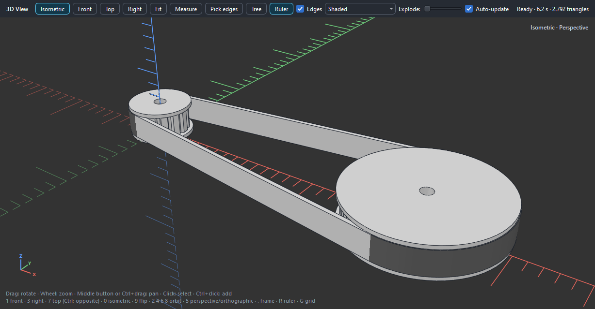 |

### Standard parts and fits
- Screws (ISO 4762, DIN 933, DIN 7991, ISO 7380), nuts (DIN 934, DIN 985), washers (DIN 125),
  heat-set inserts, ball bearings, and 2020/2040 aluminium profiles, each as a solid or as the
  matching clearance hole (ISO 273). Only the sizes listed in each standard are offered.
- **Bearing seats**: pick a bearing (60xx, 62xx, 63xx and common small ones) and a fit (G7, H7, J6,
  K6, M6, or a rough allowance for 3D printing). You get the housing limits, the shaft limits and,
  for 62xx, the shoulder diameters, plus a mask to subtract.
- **Retaining ring grooves** (metric ANSI B27.7, series 3AM1 and 3BM1) and **O-ring grooves**
  (1.78 to 6.99 mm cross-sections) on a shaft, in a bore or on a flat face.
- **Pipe flanges**: weld neck, slip-on and blind flanges from ASME B16.5-2013 (formerly ANSI B16.5),
  NPS 1/2 to 24 in classes 150 to 2500 (tables 4, 7 to 22), and weld neck (type 11), hubbed slip-on
  (type 12), blind (type 05) and plate (type 01) flanges from EN 1092-1:2018, DN 10 to 2000 in PN 6 to
  PN 100 (tables 8 and 11 to 17). Raised or flat face. The wizard only offers the sizes each table
  lists; where the standard leaves the bore to the purchaser (weld neck flanges), you enter the pipe
  bore before inserting. The part is a `pipe_flange` module with plain numbers, so it can be edited
  afterwards, and the panel warns if the bolt holes reach the hub or the rim.

Masks are subtracted from the selected part in one step.

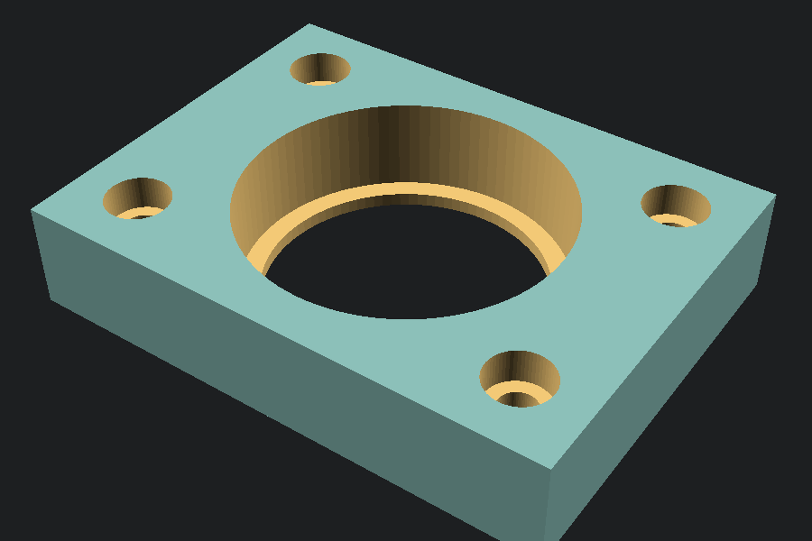

### 3D view
- OpenSCAD computes the final mesh only when the model changes; rotating, selecting and highlighting
  are instant.
- **Mesh cache**: a model that was already computed is not sent to OpenSCAD again. Undo, redo, or
  changing a value and putting it back shows the mesh at once (up to 24 models or 256 MB). Code that
  reads other files (`include`, `use`, `import`, `surface`) is always recomputed, because those files
  may have changed.
- Click a part in the view to select it, including the wall of a hole, which selects the cylinder
  that was subtracted.
- Move gizmo with snapping, measuring tool, colours from `color()`, exploded view, axis ruler and grid.
- **Display modes** (*View › Display mode* or the list in the view bar; Z over the view goes to the next
  one): shaded, shaded with mesh, wireframe, X-ray (see-through, to check holes and inner parts) and
  hidden lines removed. The choice is remembered.
- **Compact mode** (*View › Compact mode*, Ctrl+Shift+F) to give the 3D view as much screen as
  possible: the ribbon shows icons only (61 px high instead of 169, names in the tooltips), the main
  toolbar becomes a row of icons beside the ribbon tabs, the Model, Variables and Console panels are
  hidden, and the tree and properties float over the view. Leaving it restores your panels exactly as
  they were, and it is remembered between sessions. **F11** toggles full screen.
- Blender-style view keys (1, 3, 7, 0, 5…) and OpenSCAD colour schemes.
- Works without OpenSCAD too: you then see an approximate model, without the boolean operations.
- **Faster renders for big models**: OpenSCAD's default engine (CGAL) can take tens of seconds on
  models with tens of thousands of triangles, such as gear trains. With an OpenSCAD development
  snapshot, choose *Manifold (fast)* in *Edit › Preferences*: the same model renders many times faster.

### Code, drawings and export
- Code editor in sync with the tree: click a line to select the part, edit by hand and apply with
  Ctrl+Enter, autocompletion, parameter hints and snippets.
- Technical drawing on A4/A3 with first-angle (ISO E) front, top, side and isometric views, exported
  to PDF (at true scale, on a page the size of the sheet), SVG or DXF (one layer per line type):
  - The views are drawn from OpenSCAD's final mesh: visible edges and outlines as thick lines, hidden
    edges dashed (optional), and centre lines on every hole and round edge.
  - ISO 5457 border with grid references and centring marks, and an ISO 7200 title block: company,
    title and description, drawing number and revision, material, mass (from the volume and the
    material's density), overall size, scale, sheet size, the first-angle projection symbol,
    general tolerances, drawn and checked by, and date. Notes go above the title block.
  - Overall dimensions on the front and top views.
  - The automatic scale picks the largest standard one (ISO 5455) that fits. If only the isometric
    is in the way, it gets a smaller scale, shown in its label.
  - *Insert into model* still adds the views as OpenSCAD `projection()` outlines.
- Export to STL, 3MF, OBJ, OFF, AMF, SVG, DXF, PDF and PNG through OpenSCAD.
- Interface in English, Spanish, French, German, Italian and Portuguese, with a light and a dark theme.

## Getting started

### Requirements
- Windows (the platform it is developed and tested on). It is plain Python and Qt, so Linux and macOS
  should work, but they have not been tested.
- Python 3.10 or newer.
- [OpenSCAD](https://openscad.org/downloads.html) 2021.01 or newer, installed or as a portable copy
  next to the program. Without it you get the approximate preview and no export.

### Run it
On Windows, double-click `run.bat`: it installs the packages the first time and starts the program.
Elsewhere:

```bash
python -m pip install -r requirements.txt
python main.py                 # empty model; examples are in the File menu
python main.py part.scad       # open a file
```

The interface starts in Spanish; change it in *Edit › Preferences*. If the 3D view does not work on
your machine, untick *View › OpenGL viewport* and restart: the program falls back to images rendered
by OpenSCAD.

### Portable Windows build
```bash
python -m pip install pyinstaller
python build_portable.py
```
This produces `dist/OpenSCAD_GUI_Mejorada.exe` and a zip with the examples. OpenSCAD is not bundled.

## Before you machine or print anything

- The dimension tables were read from the cited books, and some of them come out jumbled in the PDF
  text, so check critical values against a manufacturer's catalog. Places where this applies are
  marked in [CONTEXTO_PARA_IA.md](CONTEXTO_PARA_IA.md): for example the 60xx and 63xx bearing series,
  the rotating-shaft fit choice, and the flat-face O-ring groove, which the Handbook does not cover.
- A mesh cannot hold a tolerance of hundredths of a millimetre. For fits, machine to the values the
  dialog lists, not to the exported STL.
- The 3D-printing allowances are starting points, not standards. Print a test piece first.
- Belt drives: pick the final belt from a maker's catalogue. The V-belt length the calculator gives is
  the pitch (datum) length; some catalogues name belts by their inside or outside length instead.
- Parts are modelled for fit-checking and drawings: no threads, flat roots instead of fillet radii,
  and no tolerance classes on gears. Flanges have no fillet radii, weld bevel or facing finish.
- The flange tables are those of the editions listed above (ASME B16.5-2013 and EN 1092-1:2018).
  Newer editions exist; check them, or your supplier's catalog, before ordering or machining.
- The standards themselves are copyrighted and are not part of this repository; only the dimension
  values are used, each one with the table it comes from.

## Known limitations

- Only `cube` and straight `cylinder` edges can be rounded, one radius per part. There is no general
  fillet on any edge.
- Picking in the 3D view works for parts with literal values. Text, imports, the result of
  `hull`/`minkowski` and parts driven by variables must be selected in the tree or the code.
- Comments placed between the arguments of a call are lost when the code is regenerated.
- The 2D profile wizard is form based; there is no constraint-driven sketcher.
- Source code comments and internal notes are in Spanish. Generated OpenSCAD code is commented in
  English.

## How it is built

- Python 3 and PySide6 (Qt 6); the 3D view uses pyqtgraph, PyOpenGL and numpy.
- The model is the source of truth, like an ORM: the interface edits a document of nodes, and the
  generator turns it into OpenSCAD code. A tolerant parser turns code back into nodes.
- All logic (model, parser, geometry, gear and standard-part maths) lives outside the Qt code and is
  tested without a window.

### Tests
About 200 automated tests:

```bash
python tests/test_core.py        # model, generator, parser round trip, standard parts, tables
python tests/test_geometry.py    # meshes, volumes, picking, exploded view
python tests/test_i18n.py        # every interface text translated in the 5 other languages
python tests/test_tema.py        # dark theme contrast
python tests/test_openscad.py    # renders generated code with the real OpenSCAD and checks volumes
python tests/test_ventana_qt.py  # real mouse events and dialogs on the real Qt window
```

On Windows, `run_tests.bat` runs them all. The first three need neither Qt nor OpenSCAD and run on
every push (see `.github/workflows`).

## How this was made

This project is developed with heavy help from an AI coding assistant (Anthropic's Claude), directed
and tested by a human user who designs mechanical parts. The safeguards are the ones described above:
cited sources for every dimension table, comparisons against the real OpenSCAD, and a test suite that
has to pass before each change is committed. If you find a wrong dimension or a bug, please open an
issue with the part, its parameters and the source you checked against.

## Contributing

Issues and pull requests are welcome, in English or Spanish. Start with [CONTRIBUTING.md](CONTRIBUTING.md):
how the code is organised, the rules that keep `.scad` files lossless, how to add a part or a language,
and how to run the tests. [CONTEXTO_PARA_IA.md](CONTEXTO_PARA_IA.md) (in Spanish) has the full
architecture notes and the lessons learned so far.

## License

Copyright (C) 2026 luisxbrito.

This program is free software: you can redistribute it and/or modify it under the terms of the GNU
General Public License as published by the Free Software Foundation, either version 3 of the License,
or (at your option) any later version (`GPL-3.0-or-later`). It is distributed in the hope that it will
be useful, but WITHOUT ANY WARRANTY. See [LICENSE](LICENSE) for the full text.
